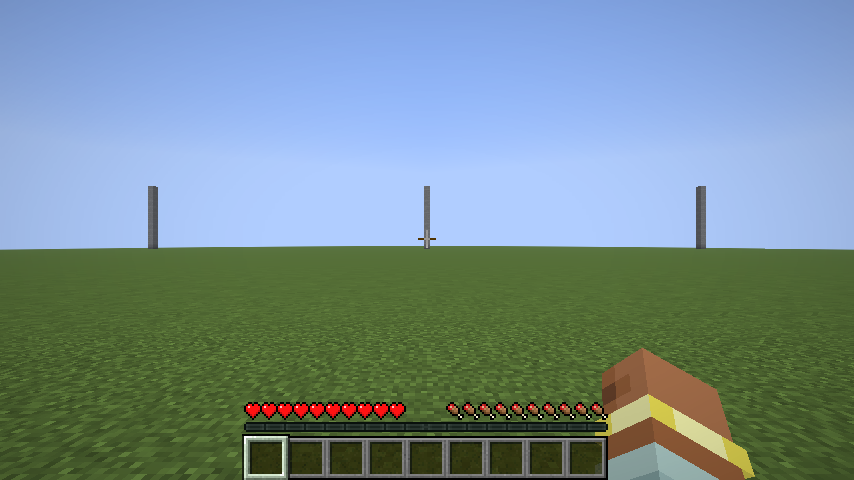
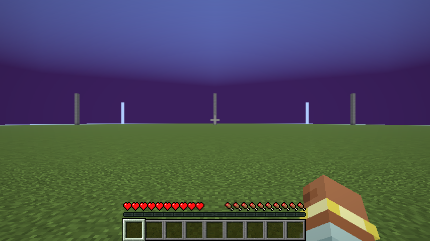
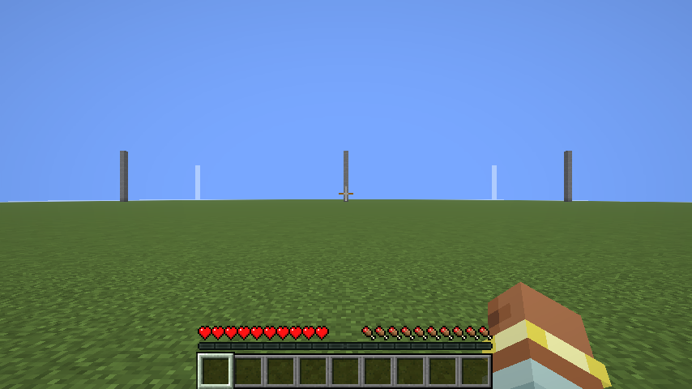
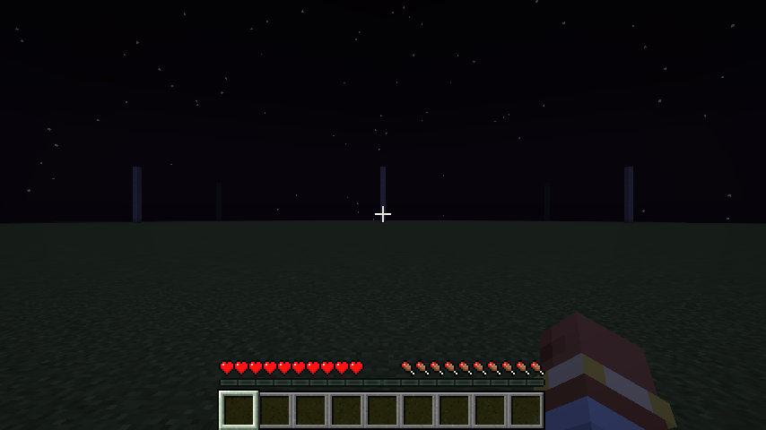

# OG Fog

the old minecraft fog is back, and you pick how it looks. choose the fog color, where it starts and where it ends, so the far edge of the world fades into your resource pack instead of a white wall.

client side fabric mod for 1.21.11. settings through mod menu with cloth config, or with the `/ogfog` command (needs fabric api).

- **og fog on**: turn it off for the normal game fog
- **color mode**: vanilla (normal fog color), custom color or sky color
- **fog color**: any color. it is also the color you see where chunks are not loaded yet, so you never get the white flash when you load new chunks
- **dim at night**: darkens the fog color at night and in storms like the normal fog does (default on)
- **fog start**: where the fog begins, in percent of your render distance (default 55%)
- **fog end**: where the fog is fully thick, in percent of your render distance (default 100%). lower it for a close wall of fog
- **sky fog**: how far the fog reaches into the sky near the horizon (default 100%)
- **nether and end**: use the settings there too (default off)

## commands

- `/ogfog` shows the current settings
- `/ogfog on` and `/ogfog off`
- `/ogfog color 3a1f5c` sets a custom color (hex)
- `/ogfog mode vanilla`, `custom` or `sky`
- `/ogfog start 0-95`, `/ogfog end 5-100`, `/ogfog sky 10-300`

## download

`og-fog-mc1.21.11-1.0.0.jar` on the releases page. minecraft 1.21.11, fabric loader 0.16 or newer, fabric api.

## pictures

same spot, same render distance. normal fog and the default purple:

| normal | og fog default |
|---|---|
|  |  |

a close wall of fog (start 10%, end 50%) and the sky color mode:

| start 10%, end 50% | sky color |
|---|---|
|  |  |

at night the fog dims with the sky:

## tip for resource packs with a custom sky

set the fog color to the dark color of your sky (for a purple pack something like `1e0a3c`), turn dim at night off if your sky stays the same all day, and set the fog end to 100%. the far edge of the world then fades into the same color as the sky.

## how it works

a mixin on `FogRenderer`. when the fog values are written for the frame, the mod swaps in your color, start and end. the same color is used to clear the screen, which is why unloaded chunks show your color. water, lava, powder snow, blindness and darkness keep their own fog.

## tests

`./gradlew runClientGameTest` makes a flat world with a few pillars and takes screenshots of normal fog, the default, a close wall, sky color, night with and without dimming and the commands. it also checks the config and opens the cloth config screen. it was also run with sodium, sodium extra, scalablelux, badoptimizations, immediatelyfast, lithium and nuit loaded.

license: MIT
