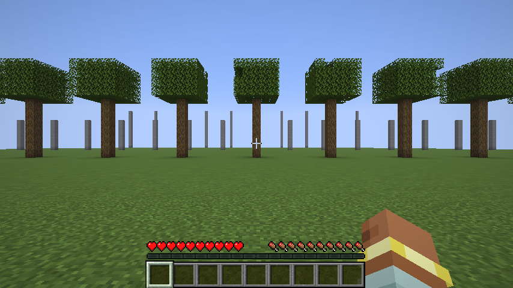
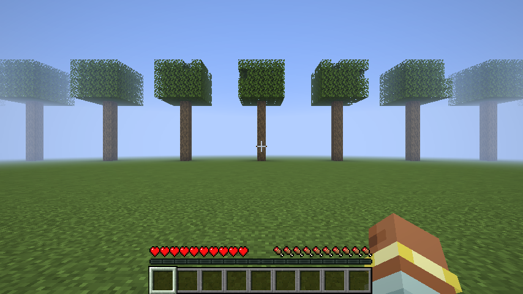
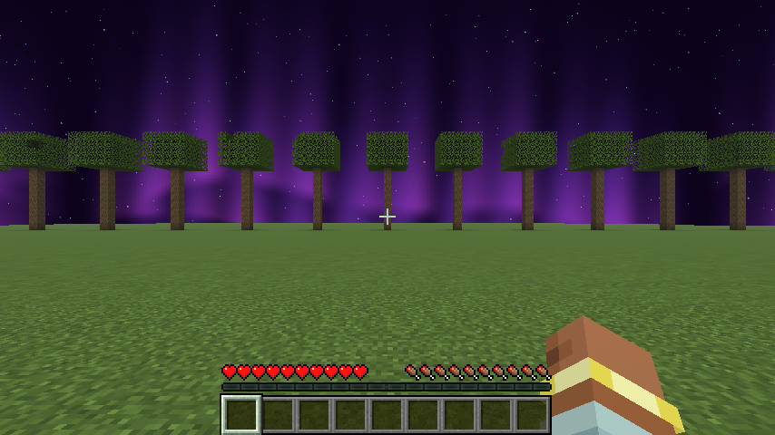
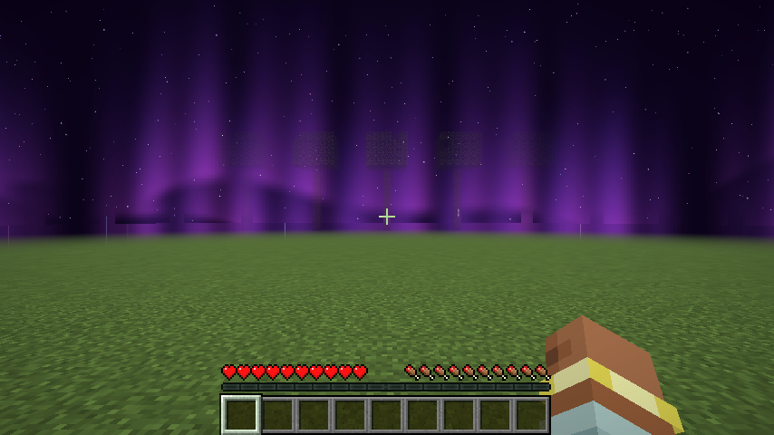
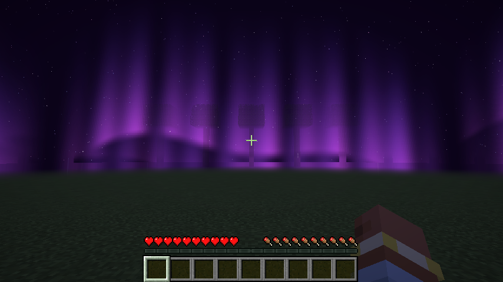
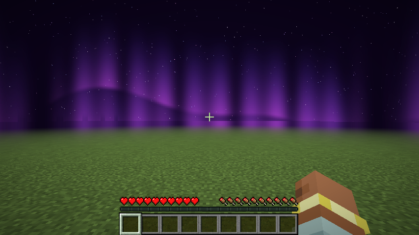
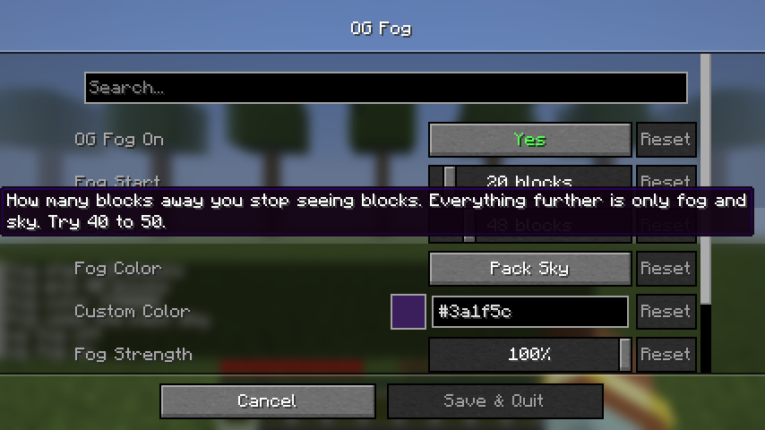

# OG Fog

the old minecraft fog is back and it blends into your sky. blocks fade into the sky behind them from every direction around you, so the world has depth and no white wall at the end of your render distance. with a resource pack that has a custom sky the fog takes the colors of that sky.

client side fabric mod for 1.21.11. settings through mod menu with cloth config, or with the `/ogfog` command (needs fabric api).

- **og fog on**: turn it off for the normal game fog
- **fog start**: how many blocks away from you the fog starts (default 20)
- **fog end**: how many blocks away you stop seeing blocks (default 48). set it to 40 to 50 for the old close fog
- **fog color**: pack sky (default) or a custom color. pack sky makes the fog the color of the sky behind each block, so it matches any sky, also custom ones from resource packs
- **fog strength**: how thick the fog gets at the end. 100% hides everything behind it
- **soft fade**: fades the fog in smoothly, turn it off for the straight line fade of the old game
- **nether and end**: use the fog there too (default off)

## commands

- `/ogfog` shows the current settings
- `/ogfog on` and `/ogfog off`
- `/ogfog start 20` and `/ogfog end 48` (in blocks)
- `/ogfog strength 100`
- `/ogfog sky` uses the pack sky, `/ogfog color 3a1f5c` uses a custom color

## download

`og-fog-mc1.21.11-1.1.0.jar` on the releases page. minecraft 1.21.11, fabric loader 0.16 or newer, fabric api.

## pictures

normal fog and og fog, same spot, normal sky:

| normal | og fog |
|---|---|
|  |  |

with a resource pack that has a custom sky (Crystal Universals Original):

| normal | og fog |
|---|---|
|  |  |

| dusk | start 10, end 40 |
|---|---|
|  |  |

## how it works

the sky is drawn first, so the mod copies the picture right after the sky and before the terrain. at the end of the frame every pixel that is a block or an entity gets mixed with the sky behind it, by how far it is from you. blocks under the horizon use the sky at the horizon in the same direction. the normal game fog is turned off for the terrain so only this fog is used. water, lava, powder snow, blindness and darkness keep their own fog.

all rights reserved. made by wysss.
